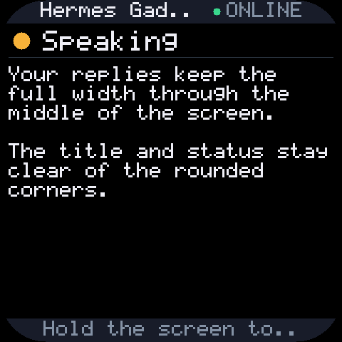

# Rounded screen layout

The 2.16-inch device has a 480×480 framebuffer, but its physical screen opening has rounded corners. The original profile placed the device name and connection label too close to the top corners; the owner's photo showed both clipped.

Firmware **0.2.0-rounded.1** adds 48 pixels of side padding through the existing board `corner_inset` field. The footer also respects that inset, shortening long hints with an ellipsis. The middle of the screen keeps its full width, and the framebuffer, touch transform, audio, network and pairing behavior are unchanged.



This is a render from the production UI code with an approximate physical corner mask for preview. The firmware does not paint that mask or turn the screen into a circle. Long names and hints are fitted inside the safe area instead of being cut off by the hardware.

## Rebuild

`scripts/build.py` exports the pinned upstream SDK into an ignored, generated directory under `build/`, applies [`rounded-layout.patch`](../firmware/waveshare-216/rounded-layout.patch), then compiles and packages only this board. The `sdk/` submodule stays unchanged. Use `--prepare-only` to inspect or run host tests against the generated source before compiling firmware.

The overlay contains the board setting, footer fitting, firmware version, a changelog entry and a pixel regression test. The test renders a long device title and footer and checks that both bars have no foreground pixels in the unsafe side strips. The full 253-case portable core suite, including circular-display behavior, passes.

## Update a paired board

Use the app-only image through the matching Hermes plugin:

```bash
hermes gadget devices
hermes gadget update DEVICE_ID firmware/waveshare-216/hermes-gadget-esp32s3-touch-amoled-216-0.2.0-rounded.1-app.bin
```

Replace `DEVICE_ID` with your board's ID. This uses the existing OTA slots and keeps Wi-Fi, device identity and pairing. The first-install `scripts/flash.py` command writes a merged image and clears settings; use it only for first installation or recovery.
