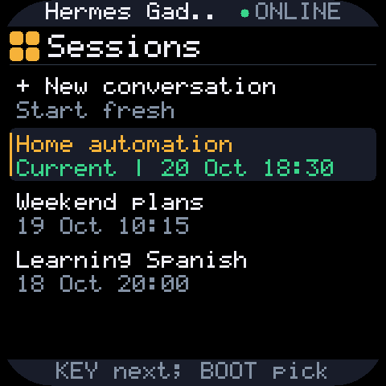

# Sessions and buttons on the 2.16-inch board

Firmware **0.2.0-sessions.1** adds the GPIO18 button marked **+/KEY** (KEY3) and a session browser. Install the matching Mac plugin as well as the device app; the upstream plugin does not implement the history messages.

| Button | Normal screen | Sessions page |
|---|---|---|
| BOOT | Hold to talk; release to send | Click to select the highlighted item |
| +/KEY | Click to cancel/back; double-click within 0.5 seconds for a new conversation; hold 2 seconds to open Sessions | Click for the next item; hold 2 seconds to return |
| PWR | Click to sleep/wake the screen; hardware hold powers off | Same |

PWR double-click has no additional action. Its long hold belongs to the AXP2101 power controller. The first touch or BOOT/KEY press on a dark screen only wakes it; release and press again to act. BOOT plus KEY still opens local settings, and holding the title opens settings outside the browser.

## Pick a conversation

Hold **+/KEY for two seconds** to open Sessions. Opening the page preserves the current conversation and does not cancel an agent turn.



The screenshot uses example conversations and an approximate physical corner mask. The firmware still draws the full 480×480 framebuffer.

- The first row starts a new conversation.
- Recent conversations show a title (or first-message preview), last activity, and a **Current** badge.
- Swipe vertically to move through the list, or click +/KEY. Selection wraps around.
- Tap a row, or click BOOT to select it. Picking Current simply returns to the conversation.
- Hold +/KEY for two seconds, or tap the top title bar, to return without switching.

Finish or cancel an active reply before selecting another conversation. Loading and switching errors stay visible, and the device only reports success after Hermes confirms the target is current. Approval questions take priority over browsing.

The list contains up to 20 recent, unarchived conversations belonging to this device and profile, including unnamed sessions. Other devices' conversations are excluded. Older, archived, or other-platform chats remain accessible through Hermes on the Mac. Switching uses Hermes's normal `/resume ID` path to restore the transcript and reset conversation-specific agent state; it does not edit conversation routing directly.

## Build and install the matching plugin

```bash
python scripts/build.py --prepare-only
python scripts/install-plugin.py
hermes gateway restart
python scripts/build.py
hermes gadget update DEVICE_ID build/waveshare-216/hermes-gadget-esp32s3-touch-amoled-216-0.2.0-sessions.1-app.bin
```

`install-plugin.py` prepares the same source overlay as the firmware and installs its `plugin/` files into `~/.hermes/plugins/gadget`. It preserves plugin data, pairing, and Hermes configuration. Restart the gateway after copying the files. Use `--home PATH` for another Hermes profile.

The USB/simulator console command `sessions` opens or closes the browser for diagnostics. Firmware tests cover physical click timing, wake consumption, list rendering and navigation, failures and stale responses. Python tests exercise device scoping, the actual Hermes `/resume` implementation and transcript restoration, and the simulator-to-plugin protocol.
